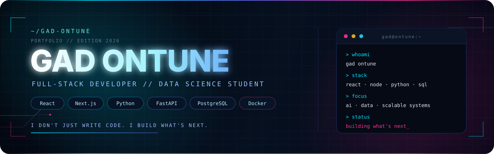
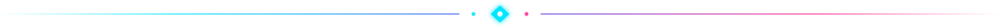
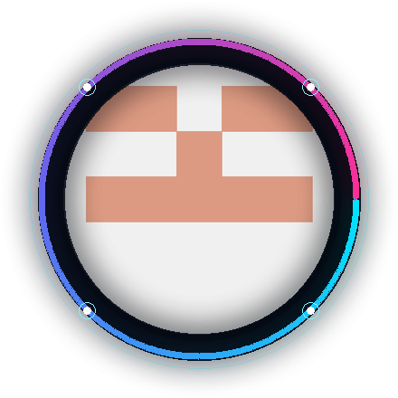
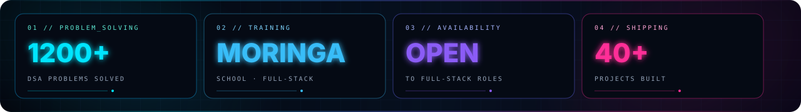
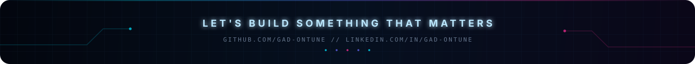

<!--
  Neon profile README for github.com/gad-ontune
  Keep README.md and the /assets folder together when publishing.
-->

  

  

  
  
  

  
  
  

<table>
  <tr>
    <td width="190" align="center" valign="middle">
      
    </td>
    <td valign="middle">
      <h3>I don't just write code. I build what's next.</h3>
      
Full-stack developer and Data Science student at Aditya College of Engineering, focused on scalable web architectures, AI-integrated platforms, and clean engineering. I turn complex requirements into products that feel fast, intentional, and ready for the real world.

      

        <strong>Currently:</strong> building Hymnora SDA and an AI trading signal ecosystem. 
        <strong>Open to:</strong> full-stack roles, internships, and ambitious collaborations.
      

    </td>
  </tr>
</table>

  

## `> stack`

  

| Layer | Tools |
| :--- | :--- |
| **Frontend** | React · Next.js · React Native · TypeScript · Tailwind CSS · Framer Motion |
| **Backend** | Node.js · Express · NestJS · FastAPI · Flask · Spring Boot |
| **Data** | PostgreSQL · MongoDB · MySQL · Redis · SQLite · Prisma · SQLAlchemy |
| **DevOps** | Docker · Nginx · GitHub Actions · Linux |
| **AI / ML** | Python · scikit-learn · Pandas · NumPy · OpenAI API |

## `> featured_work`

<table>
  <tr>
    <td width="50%" valign="top">
      <h3><a href="https://github.com/gad-ontune/smart-recruiter">Smart Recruiter</a></h3>
      
Technical assessment platform for recruiters to build coding challenges, MCQs, free-text and whiteboard exercises — with automated evaluation and centralized feedback.

      

        
        
        
        
        
      

    </td>
    <td width="50%" valign="top">
      <h3><a href="https://github.com/gad-ontune/construction-site-app">BuildTrack</a></h3>
      
Multi-site construction manager for crew, tasks, equipment, safety reports and materials, backed by a JWT-secured FastAPI API and shared persistence.

      

        
        
        
        
        
      

    </td>
  </tr>
  <tr>
    <td width="50%" valign="top">
      <h3><a href="https://github.com/gad-ontune/HOTEL-MANAGEMENT-SYSTEM">Hotel Management System</a></h3>
      
Full-stack hospitality platform covering reservations, room allocation, check-in/check-out, housekeeping, payments, staff and guest notifications.

      

        
        
        
        
      

    </td>
    <td width="50%" valign="top">
      <h3><a href="https://github.com/gad-ontune/inventory-management-system">Inventory Management System</a></h3>
      
Flask REST API plus an interactive terminal dashboard with barcode-powered product lookup, full CRUD, ANSI UI and a pytest-covered backend.

      

        
        
        
        
      

    </td>
  </tr>
</table>

## `> currently_building`

<table>
  <tr>
    <td width="50%" valign="top">
      <h3>Hymnora SDA</h3>
      
A performance-first digital platform for hymns, Bible, sermons, media, churches, events and live worship. Built with Next.js, FastAPI, PostgreSQL and Redis, with a PWA offline library.

      
<code>Next.js</code> <code>FastAPI</code> <code>PostgreSQL</code> <code>Redis</code> <code>PWA</code>

      PRIVATE · IN DEVELOPMENT
    </td>
    <td width="50%" valign="top">
      <h3>Deriv AI Signal System</h3>
      
A real-time AI trading assistant for Deriv volatility indices. React terminal, NestJS gateway, Python AI engine, Redis Streams, backtesting and Docker observability.

      
<code>React</code> <code>NestJS</code> <code>Python</code> <code>Redis</code> <code>Docker</code>

      PRIVATE · IN DEVELOPMENT
    </td>
  </tr>
</table>

## `> github_analytics`

  

  
  

  

<h2 align="center">LET'S BUILD SOMETHING</h2>

Have a product, platform, or ambitious idea? I'm one message away.

  
  

Clean engineering. Real products. Measurable impact.

  

